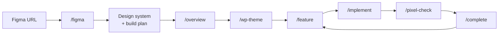

<div align="center">

# wp-ai-workflow

**From a Figma URL to a pixel-perfect custom WordPress theme, built with Claude Code.**

ACF Pro Flexible Content · Custom Post Types · Pure CSS · Vanilla JS · LocalWP


</div>

---

## Contents

- [Why](#why)
- [How it works](#how-it-works)
- [Requirements](#requirements)
- [Part 1 - Set up a new project](#part-1---set-up-a-new-project)
- [Part 2 - Build the theme foundation](#part-2---build-the-theme-foundation)
- [Part 3 - Build pages and post types](#part-3---build-pages-and-post-types)
- [Commands](#commands)
- [Theme structure](#theme-structure)
- [Deploying the theme](#deploying-the-theme)
- [Troubleshooting](#troubleshooting)
- [Credits](#credits)

## Why

Turning a Figma design into a custom theme is repetitive: extract colors and
fonts, slice sections, create ACF fields, write templates, match every pixel.
**wp-ai-workflow** gives Claude Code a set of WordPress-specific skills and
house rules so it does that work the same way every time, one reviewed
feature at a time:

- 🎨 **Paste a Figma URL** - tokens, breakpoints, fonts, and a section inventory
  are extracted for you
- 🧩 **One section = one Flexible Content layout** - ACF fields, PHP template,
  scoped CSS, optional JS, always with the same name
- 📐 **Pixel-perfect by default** - every visual step is measured against Figma
  at each breakpoint
- 🔒 **WordPress-safe** - escaping, sanitizing, nonces, and query rules are
  enforced in review
- 🧾 **Reviewable history** - every feature has a spec, a branch, a review, and
  an archive

No page builder, no CSS framework, no jQuery, no build step.

## How it works



The workflow files live **inside your theme folder**. The theme folder is your
Git repository.

```text
Local Sites/your-site/app/public/wp-content/themes/your-theme/
├── AGENTS.md          <- AI instructions (from this repo)
├── CLAUDE.md          <- Claude Code entry point (from this repo)
├── .claude/           <- skills (from this repo)
├── blueprint/         <- plans, specs, design system (from this repo)
├── .env               <- your Figma token (never committed)
└── ...theme files created by /wp-theme
```

## Requirements

| Tool | Why |
| --- | --- |
| [LocalWP](https://localwp.com/) | Local WordPress site |
| [ACF Pro](https://www.advancedcustomfields.com/pro/) | Flexible Content, options page, clone fields |
| [Claude Code](https://claude.com/claude-code) | Runs the skills (CLI or VS Code extension) |
| [Node.js 18+](https://nodejs.org/) | Figma helper and workflow scripts |
| [Git](https://git-scm.com/) | One branch per feature |
| PHP CLI | `php -l` syntax checks (LocalWP's **Open site shell** provides it) |
| Figma account | View access to the design file + a personal access token |
| Playwright MCP *(optional)* | Browser screenshots and measurements for `/pixel-check` |

## Part 1 - Set up a new project

> Do this once per website. Keep a clean copy of this repository and copy from
> it for every new project.

### 1. Create the site in LocalWP

Create a new site, for example `your-site`. It will run at
`http://your-site.local`. Start it and log in to `wp-admin`.

### 2. Install ACF Pro

**Plugins > Add New > Upload Plugin**, choose `advanced-custom-fields-pro.zip`,
then **Activate** and enter your license key.

### 3. Turn on debug logging

In LocalWP click **Go to site folder**, open `app/public/wp-config.php`, and
replace the `WP_DEBUG` line with:

```php
define( 'WP_DEBUG', true );
define( 'WP_DEBUG_LOG', true );
define( 'WP_DEBUG_DISPLAY', false );
```

PHP notices now go to `wp-content/debug.log`, which the workflow checks after
every step.

### 4. Create the theme folder

```text
Local Sites/your-site/app/public/wp-content/themes/your-theme/
```

Leave it empty for now. WordPress will not list it as a theme until
`/wp-theme` creates `style.css`; that is expected.

### 5. Copy the workflow files into the theme folder

Copy these four items from this repository into `your-theme/`:

- `AGENTS.md`
- `CLAUDE.md`
- `.claude/` *(hidden folder: enable "Show hidden items" in File Explorer, or
  `Cmd + Shift + .` in Finder)*
- `blueprint/`

Or from a terminal:

```bash
git clone https://github.com/<you>/wp-ai-workflow.git
cp -r wp-ai-workflow/{AGENTS.md,CLAUDE.md,.claude,blueprint} "path/to/themes/your-theme/"
```

### 6. Add your Figma token

1. In Figma: **Settings > Security > Personal access tokens > Generate new
   token**, scope **File content: Read-only**.
2. In `your-theme/`, create a file named `.env`:

   ```env
   FIGMA_TOKEN=figd_your_token_here
   ```

Never paste the token in chat or commit it. `.env` is git-ignored.

### 7. (Optional) Add browser automation

Needed for measured `/pixel-check` and `/check` runs:

```bash
claude mcp add playwright -- npx @playwright/mcp@latest
```

### 8. Open the theme folder in your editor

Open **`your-theme/`** (not the site root) in VS Code, then start Claude Code
there. The skills only work from this folder.

## Part 2 - Build the theme foundation

Type these commands in the Claude Code chat:

| Step | Command | What happens | What you do |
| --- | --- | --- | --- |
| 9 | `/onboard` | Checks folder, Git, PHP, ACF Pro, and the Figma token. Sets theme name, slug, and function prefix. | Answer the questions. Accept `git init`. |
| 10 | `/figma <figma-url>` | Reads the design: colors, fonts, spacing, breakpoints, sections, post types. Saves reference images. Proposes a plan. | Review the section list, answer open questions, approve the plan. |
| 11 | `/overview` | Turns the plan into a numbered, trackable feature list. | Read it. |
| 12 | `/wp-theme` | Writes the spec for feature 1: theme skeleton, tokens, header, footer, page builder. | Approve the spec. |
| 13 | `/implement` | Builds feature 1 on its own Git branch. | In **Appearance > Themes**, activate your theme. Create a test page. |
| 14 | `/pixel-check http://your-site.local/` | Compares header and footer with Figma at each breakpoint. | Ask for fixes if anything differs. |
| 15 | `/complete` | Archives the feature, then asks to commit and merge. | Approve. |

Any Figma link works: `design`, `file`, `proto`, or `board`, with or without
`?node-id=`.

## Part 3 - Build pages and post types

Repeat this loop for each item in the build plan:

```text
/feature       spec the next item (for example "Home page sections")
/implement     build each section: ACF fields + PHP + CSS + JS
               -> add the sections to the page in wp-admin with the Figma copy
/pixel-check   compare with Figma at every breakpoint
/complete      archive, commit, merge
```

After adding a Custom Post Type, go to **Settings > Permalinks** and click
**Save** once.

## Commands

### WordPress skills

| Command | Purpose |
| --- | --- |
| `/figma <url>` | Extract tokens, breakpoints, fonts, sections, and CPTs from a Figma URL |
| `/wp-theme` | Theme foundation: `functions.php`, `inc/`, enqueue, ACF setup, page builder, header, footer |
| `/section <url or name>` | One Figma section as a Flexible Content layout |
| `/acf <change>` | Create or edit ACF field groups as JSON in `acf-json/` |
| `/cpt <name>` | Custom Post Type with taxonomies, fields, archive, and single templates |
| `/pixel-check <url>` | Measure the local page against Figma, report differences |

### Workflow skills

| Command | Purpose |
| --- | --- |
| `/onboard` | Set up a new project |
| `/overview` | Generate the project overview from the plans |
| `/feature` | Spec the next build-plan item |
| `/implement` | Build the approved spec |
| `/check` | Verify the feature in the browser |
| `/audit` | Security, performance, and quality review (WordPress rules included) |
| `/complete` | Archive, commit, and merge |
| `/fix "<bug>"` | Spec and fix a bug outside the plan |
| `/status` | Where am I, what's next |
| `/brief`, `/explore`, `/debug` | Read-only help |
| `/rollback`, `/doctor` | Undo a feature, health check |

### Figma helper

All skills use one dependency-free script. You can run it yourself:

```bash
node .claude/skills/figma/scripts/figma.mjs check
node .claude/skills/figma/scripts/figma.mjs outline "<figma-url>" --depth 2
node .claude/skills/figma/scripts/figma.mjs tokens  "<figma-url>"
node .claude/skills/figma/scripts/figma.mjs images  "<figma-url>" --out blueprint/reference
```

## Theme structure

What `/wp-theme`, `/section`, and `/cpt` produce:

```text
your-theme/
├── style.css  functions.php  header.php  footer.php  page.php  index.php
├── inc/
│   ├── setup.php  enqueue.php  acf.php  helpers.php
│   └── post-types/<cpt>.php
├── acf-json/                       ACF field groups (versioned)
├── template-parts/
│   ├── flexible-content.php        renders the page builder
│   ├── sections/<section>.php      one per Flexible Content layout
│   └── components/<name>.php
└── assets/
    ├── css/variables.css           design tokens from Figma
    ├── css/base.css
    ├── css/sections/<section>.css
    └── js/main.js  js/sections/<section>.js
```

Full conventions: [`blueprint/context/coding-standards.md`](blueprint/context/coding-standards.md).

## Deploying the theme

Deployment is manual. Zip the theme folder **without** the workflow files:

```bash
zip -r your-theme.zip your-theme \
  -x "*/AGENTS.md" "*/CLAUDE.md" "*/.claude/*" "*/blueprint/*" "*/.env" "*/.git/*"
```

Upload it in **Appearance > Themes > Add New > Upload Theme**, and make sure
ACF Pro is active on the live site.

## Troubleshooting

| Problem | Fix |
| --- | --- |
| `No Figma token` | Create `.env` with `FIGMA_TOKEN=...` in the theme folder |
| `403 from Figma` | Token expired, wrong scope, or your account can't view the file |
| `php: command not found` | In LocalWP, right-click the site > **Open site shell**, start Claude Code there |
| Skills not found | Claude Code must be opened in the theme folder, not the site root |
| Theme not listed in WordPress | Normal until `/wp-theme` creates `style.css` |
| CPT pages return 404 | **Settings > Permalinks > Save** |
| "Sync available" in ACF | The JSON in `acf-json/` is newer than the database; sync only if you edit fields in the admin |

## Credits

Built on the [AI Blueprint](https://ai-blueprint.dev/docs/getting-started/)
workflow, adapted for Figma-to-WordPress theme development.
